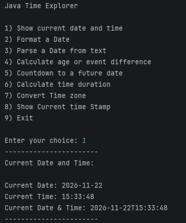
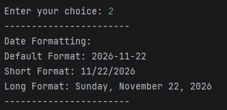
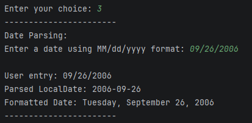
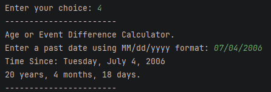
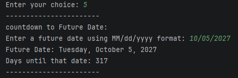
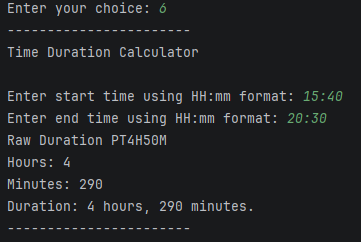
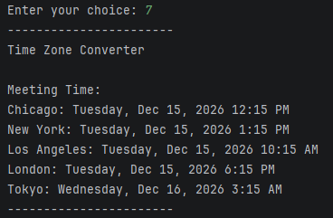
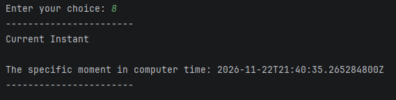

# Time Explorer

## Description
This Java program work with dates and time, parsing and formatting the timestamps
to display the time/date data as required according its desired display/use.

The program work to handle the following:
- Dates
- Times
- Date/Time combinations
- Formating
- Parsing
- Time difference
- Durations
- Time zones
- Timestamps

## Features - Needs to corrected
1. Show current date and time
2. Format a date
3. Parse a date from text
4. Calculate age or event difference
5. Countdown to a future date
6. Calculate time duration
7. Convert time zones
8. Show current timestamp

## Reflection
**Which Java date/time class was easiest to understand?**

`LocalDate` was the easiest class to understand, because its name suggest its behavior when working with dates.
This class can represent a date without a time-zone in the ISO calendar system, for instance 2006-09-26.

**Which Java date/time class was most confusing?**

The `ChronoUnit` class was a bit confusing because it does not have an explicit semantic meaning.
It provides a set of date and time units ranging from NANOS to ERAS to manipulate temporal objects.
I used the `ChronoUnit` and it was really helpful to truncate some LocalTime and LocalDateTime timestamps to seconds
and calculate the period (days) between a currentDate and futureDate. It can also be used to add/subtract time.

**Why is it better to use date/time classes instead of storing dates and times only as strings?**

Because classes are more efficient, maintain data integrity, and usually require fewer bytes of storage
compared to a string.

**What is the difference between Period and Duration?**

Learning the difference between the `Period` and `Duration` classes was a bit confusing at the beginning,
especially because these nouns are synonyms. `Period` uses years, months and days to represent calendar time while `Duration`
uses seconds and nanoseconds to represent exact physical time.

**Why might time zones matter in real software?**

Time zones are crucial for real world software and a fundamental part of many features we interact with.
Things like setting up online meetings across different locations (customer service, business meetings), calculating the current time,
and forecasting the weather wouldn't be possible without having time zone setting within software.

## How to Run
1. Open the project in your preferred Java IDE.
2. Make sure the JDK is installed and configured.
3. Run `JavaEplorer.java`

## Features - Screenshots

**Feature 1: Current Date and Time Display**

**Feature 2: Date Formatting**

**Feature 3: Date Parsing**

**Feature 4: Age or Event Difference Calculator**

**Feature 5: Countdown to a Future Date**

**Feature 6: Time Duration Calculator**

**Feature 7: Time Zone Converter**

**Feature 8: Instant / Timestamp Display**

